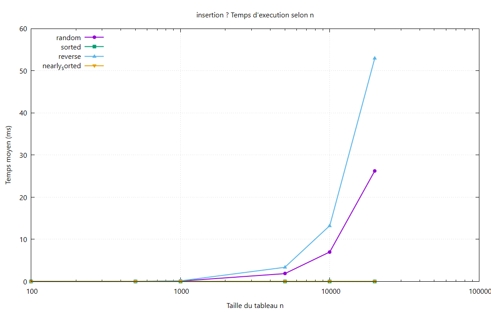

# Insertion Sort

## Principe
On construit la partie gauche déjà triée. Chaque nouvel élément est **inséré** à sa place en décalant les plus grands.

## Complexité

| Cas | Temps | Mémoire |
|-----|-------|---------|
| Meilleur (`sorted`) | \(O(n)\) | \(O(1)\) |
| Moyen | \(O(n^2)\) | \(O(1)\) |
| Pire (`reverse`) | \(O(n^2)\) | \(O(1)\) |

## Résultats observés
- Favorable : `sorted` (quasi instantané).
- Défavorable : `reverse` (≈ **204 ms** à n = 20 000).
- `random` ≈ 77 ms à n = 20 000.

## Théorie / expérience
Doubler n sur `reverse` multiplie le temps par ≈ 4 → cohérent avec \(O(n^2)\).  
Tailles limitées à n ≤ 20 000 (algo trop lent au-delà).
