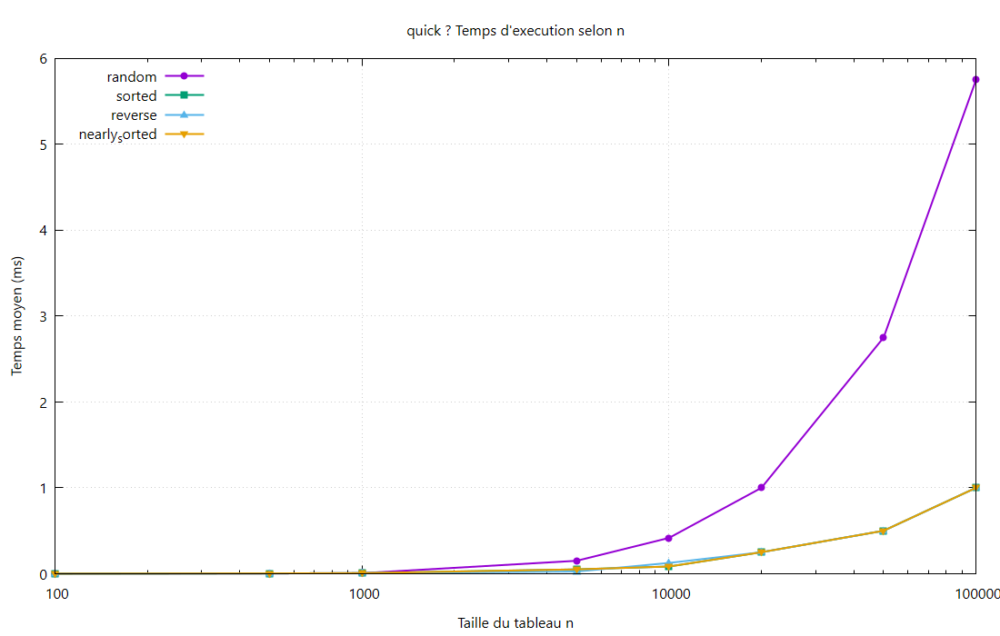

# Quick Sort

## Principe
Choix d’un **pivot** (élément du milieu), partition du tableau, puis tris récursifs.

## Complexité

| Cas | Temps | Mémoire |
|-----|-------|---------|
| Meilleur / moyen | \(O(n\log n)\) | \(O(\log n)\) |
| Pire | \(O(n^2)\) | \(O(\log n)\) |

## Résultats observés
- Stable sur les 4 types (pivot médian).
- `random` ≈ **12.9 ms** à n = 100 000.
- Pas de dégénérescence observée sur `sorted` / `reverse`.

## Théorie / expérience
Croissance proche de \(n\log n\). Bien plus rapide qu’Insertion dès que n est grand.
