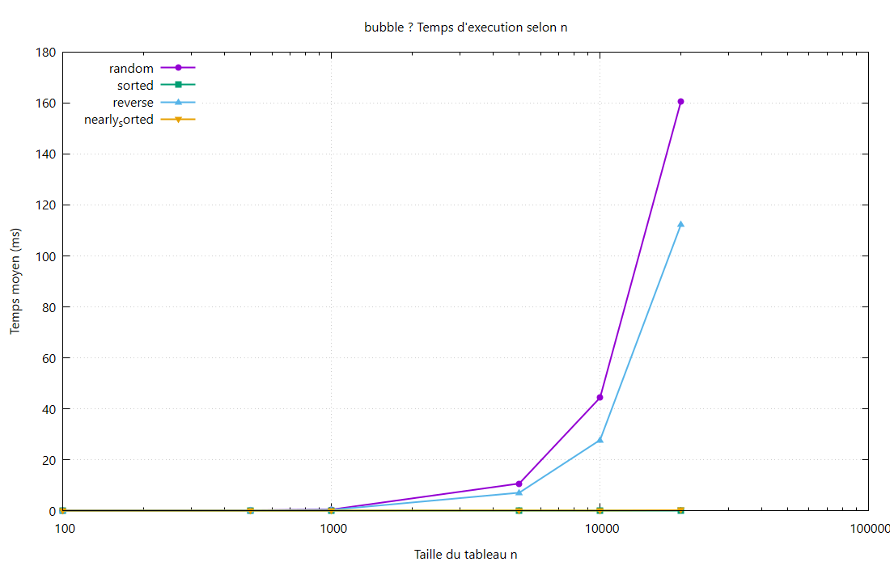
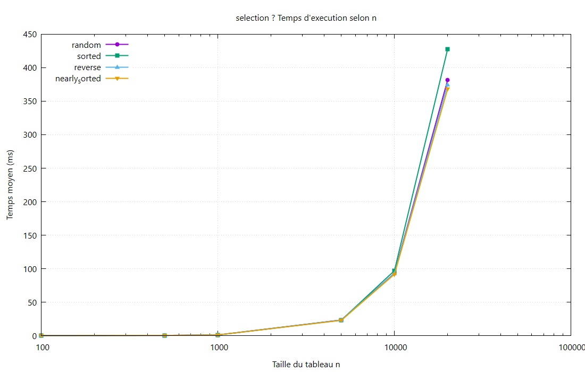
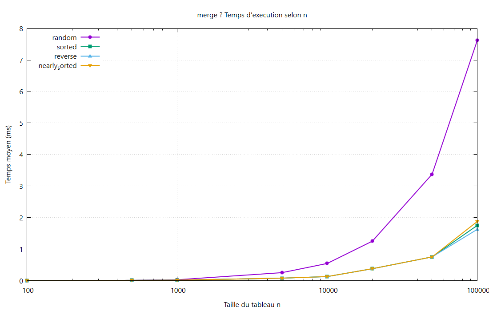
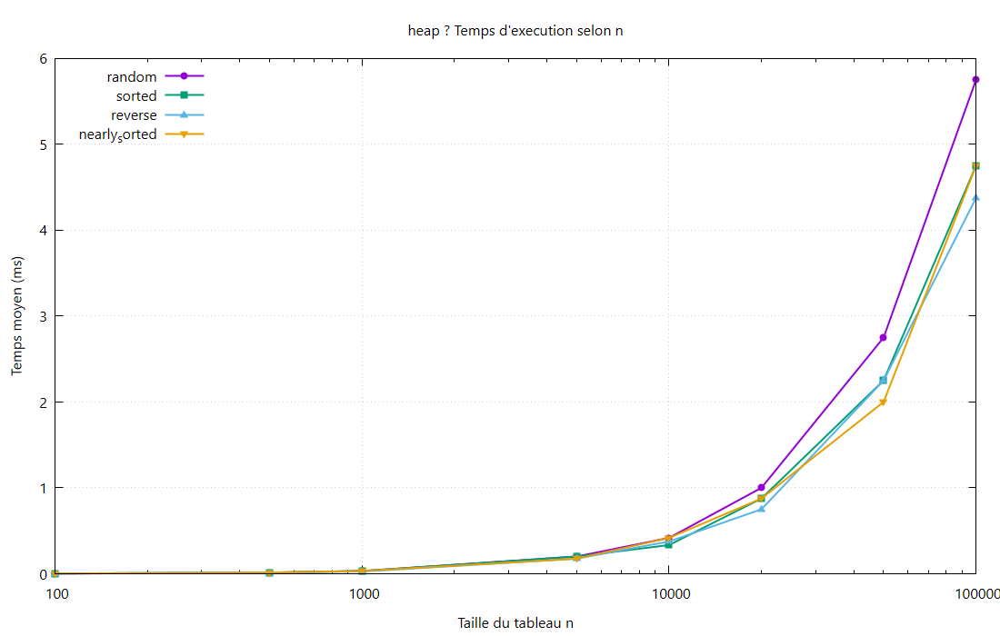
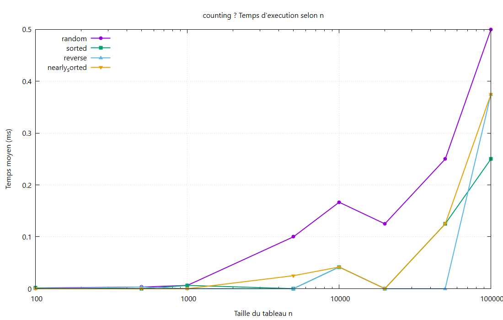
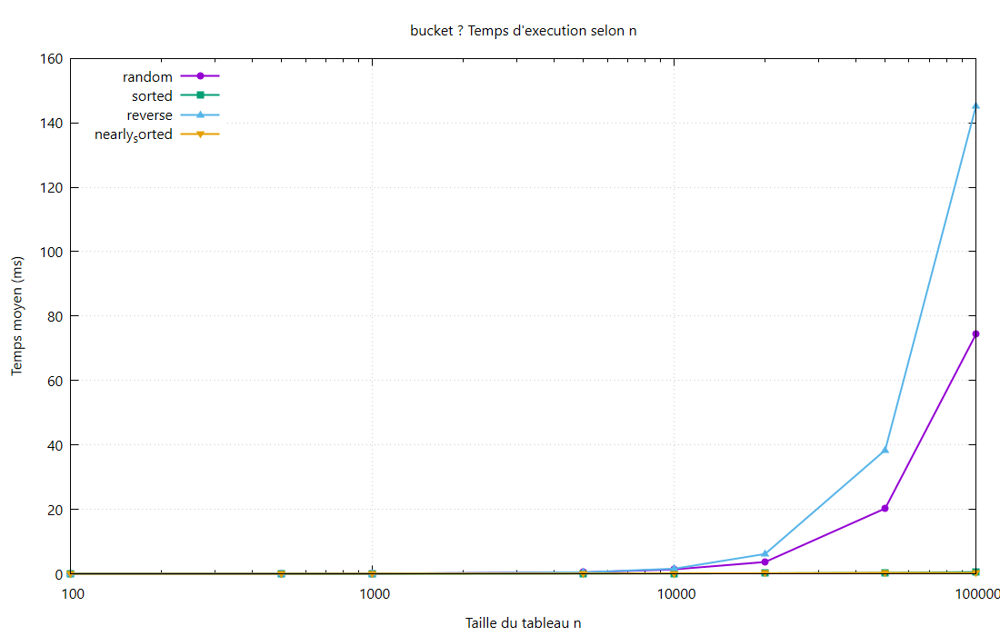
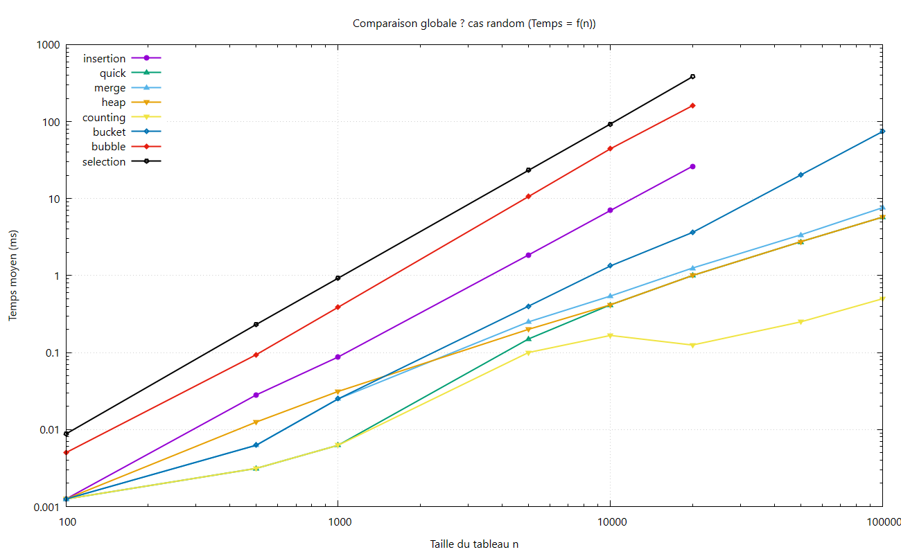

# Rapport — Étude expérimentale des algorithmes de tri

**Projet :** Benchmark comparatif des algorithmes de tri en C  
**Mesure :** `clock()` (`<time.h>`), temps moyen en **millisecondes (ms)**  
**Types de tableaux :** `random`, `sorted`, `reverse`, `nearly_sorted`  
**Tailles n :** 100, 500, 1 000, 5 000, 10 000, 20 000, 50 000, 100 000  
*(Pour les algorithmes O(n²) : Bubble, Selection, Insertion → n limité à 20 000)*

---

## 1. Introduction

Trier des données est une opération très courante en informatique.  
Il existe plusieurs algorithmes de tri. Ils ne sont **pas tous égaux** :

- certains sont **simples** mais **lents** sur de grands tableaux ;
- d’autres sont **plus rapides**, mais un peu plus complexes ;
- certains demandent **plus de mémoire** ;
- certains sont adaptés seulement à des cas particuliers (ex. entiers positifs).

L’objectif de ce travail est de **comparer expérimentalement** 8 algorithmes de tri :

| Famille | Algorithmes |
|---------|-------------|
| Simples (souvent O(n²)) | Bubble, Selection, Insertion |
| Efficaces (souvent O(n log n)) | Quick, Merge, Heap |
| Spéciaux (selon les données) | Counting, Bucket |

Pour chaque algorithme, nous présentons :

1. l’idée (comment ça marche) ;
2. les étapes de l’algorithme ;
3. le code C utilisé ;
4. la complexité ;
5. un tableau de résultats ;
6. un graphique.

Ensuite, nous comparons **tous les algorithmes ensemble** et nous indiquons **dans quel cas utiliser chacun**.

---

## 2. Protocole expérimental (comment on a mesuré)

Pour que la comparaison soit juste, tous les tests suivent les **mêmes règles** :

- langage : **C** ;
- même méthode de temps : `clock()` ;
- même unité : **ms** ;
- moyenne sur plusieurs exécutions ;
- vérification que le tableau est bien trié après chaque test ;
- mêmes types de tableaux :
  - `random` : valeurs aléatoires ;
  - `sorted` : déjà trié ;
  - `reverse` : trié à l’envers ;
  - `nearly_sorted` : presque trié.

Le code source est organisé **par algorithme** (un dossier = un tri).  
Les résultats sont dans `visualisation/csv/resultats.csv`.

---

## 3. Étude de chaque algorithme

---

### 3.1 Bubble Sort (tri à bulles)

#### Idée
On compare les éléments **voisins**.  
S’ils sont dans le mauvais ordre, on les **échange**.  
Les grands éléments “remontent” vers la fin, comme des bulles.  
Si un passage ne fait **aucun échange**, on s’arrête (tableau déjà trié).

#### Algorithme (étapes)
1. Parcourir le tableau du début vers la fin.
2. Comparer chaque paire de voisins.
3. Échanger si besoin.
4. Répéter plusieurs passages.
5. Arrêter si aucun échange n’a eu lieu.

#### Code C

```c
void bubbleSort(int arr[], int n)
{
    int i, j, echange, tmp;

    for (i = 0; i < n - 1; i++) {
        echange = 0;
        for (j = 0; j < n - i - 1; j++) {
            if (arr[j] > arr[j + 1]) {
                tmp = arr[j];
                arr[j] = arr[j + 1];
                arr[j + 1] = tmp;
                echange = 1;
            }
        }
        if (echange == 0)
            break;
    }
}
```

#### Complexité

| Cas | Temps | Mémoire |
|-----|-------|---------|
| Meilleur (`sorted`) | O(n) | O(1) |
| Moyen | O(n²) | O(1) |
| Pire | O(n²) | O(1) |

#### Résultats (ms)

| n | random | sorted | reverse | nearly_sorted |
|--:|-------:|-------:|--------:|--------------:|
| 100 | 0.005 | 0 | 0.004 | 0 |
| 1000 | 0.388 | 0 | 0.281 | 0 |
| 10000 | 44.333 | 0 | 27.708 | 0 |
| 20000 | **160.625** | **0** | 112.250 | 0.125 |

#### Graphique



#### Observation simple
- Très bon si le tableau est déjà trié.
- Très lent dès que le tableau est désordonné.

---

### 3.2 Selection Sort (tri par sélection)

#### Idée
À chaque étape, on cherche le **plus petit** élément restant,  
puis on le place à sa position finale.

#### Algorithme (étapes)
1. Pour i de 0 à n-2 :
2. Chercher l’indice du minimum dans `arr[i .. n-1]`.
3. Échanger ce minimum avec `arr[i]`.

#### Code C

```c
void selectionSort(int arr[], int n)
{
    int i, j, indice_min, tmp;

    for (i = 0; i < n - 1; i++) {
        indice_min = i;
        for (j = i + 1; j < n; j++) {
            if (arr[j] < arr[indice_min])
                indice_min = j;
        }
        if (indice_min != i) {
            tmp = arr[i];
            arr[i] = arr[indice_min];
            arr[indice_min] = tmp;
        }
    }
}
```

#### Complexité

| Cas | Temps | Mémoire |
|-----|-------|---------|
| Tous les cas | O(n²) | O(1) |

#### Résultats (ms)

| n | random | sorted | reverse | nearly_sorted |
|--:|-------:|-------:|--------:|--------------:|
| 100 | 0.009 | 0.006 | 0.009 | 0.006 |
| 1000 | 0.925 | 0.919 | 0.913 | 0.888 |
| 10000 | 93.042 | 96.917 | 92.792 | 91.500 |
| 20000 | **381.250** | **427.500** | 374.750 | 367.875 |

#### Graphique



#### Observation simple
- Toujours lent, même si le tableau est déjà trié.
- Peu d’échanges, mais beaucoup de comparaisons.

---

### 3.3 Insertion Sort (tri par insertion)

#### Idée
On construit petit à petit une partie gauche déjà triée.  
Chaque nouvel élément est **inséré** à sa bonne place.

#### Algorithme (étapes)
1. Prendre l’élément courant (`cle`).
2. Décaler vers la droite les éléments plus grands.
3. Insérer `cle` dans le “trou” libre.
4. Passer à l’élément suivant.

#### Code C

```c
void insertionSort(int arr[], int n)
{
    int i, j, cle;

    for (i = 1; i < n; i++) {
        cle = arr[i];
        j = i - 1;
        while (j >= 0 && arr[j] > cle) {
            arr[j + 1] = arr[j];
            j = j - 1;
        }
        arr[j + 1] = cle;
    }
}
```

#### Complexité

| Cas | Temps | Mémoire |
|-----|-------|---------|
| Meilleur (`sorted`) | O(n) | O(1) |
| Moyen | O(n²) | O(1) |
| Pire (`reverse`) | O(n²) | O(1) |

#### Résultats (ms)

| n | random | sorted | reverse | nearly_sorted |
|--:|-------:|-------:|--------:|--------------:|
| 100 | 0.001 | 0 | 0.003 | 0 |
| 1000 | 0.088 | 0 | 0.138 | 0 |
| 10000 | 7.000 | 0 | 13.250 | 0 |
| 20000 | **26.250** | **0** | **53.000** | 0 |

#### Graphique


#### Observation simple
- Excellent sur `sorted` et `nearly_sorted`.
- Mauvais sur `reverse` et sur les grands tableaux aléatoires.

---

### 3.4 Quick Sort

#### Idée
On choisit un **pivot**.  
On sépare le tableau en deux parties :
- valeurs ≤ pivot ;
- valeurs > pivot.  
Puis on recommence sur chaque partie (récursivité).

Dans notre code, le pivot est l’élément du **milieu**  
(pour éviter le pire cas sur tableaux déjà triés).

#### Algorithme (étapes)
1. Choisir un pivot.
2. Partitionner le tableau.
3. Trier la partie gauche.
4. Trier la partie droite.

#### Code C

```c
void quickSort(int arr[], int n)
{
    if (n > 1)
        quickSortRec(arr, 0, n - 1);
}

/* partitionner + quickSortRec : voir source/quick/quick_sort.c */
```

Version complète utilisée dans le projet :

```c
static int partitionner(int arr[], int debut, int fin)
{
    int milieu = debut + (fin - debut) / 2;
    int pivot, i, j;

    echanger(&arr[milieu], &arr[fin]);
    pivot = arr[fin];
    i = debut - 1;

    for (j = debut; j < fin; j++) {
        if (arr[j] <= pivot) {
            i = i + 1;
            echanger(&arr[i], &arr[j]);
        }
    }
    echanger(&arr[i + 1], &arr[fin]);
    return i + 1;
}

static void quickSortRec(int arr[], int debut, int fin)
{
    int p;
    if (debut < fin) {
        p = partitionner(arr, debut, fin);
        quickSortRec(arr, debut, p - 1);
        quickSortRec(arr, p + 1, fin);
    }
}
```

#### Complexité

| Cas | Temps | Mémoire |
|-----|-------|---------|
| Meilleur / moyen | O(n log n) | O(log n) |
| Pire | O(n²) | O(log n) |

#### Résultats (ms)

| n | random | sorted | reverse | nearly_sorted |
|--:|-------:|-------:|--------:|--------------:|
| 1000 | 0.006 | 0.006 | 0.006 | 0.006 |
| 10000 | 0.417 | 0.083 | 0.125 | 0.083 |
| 20000 | 1.000 | 0.250 | 0.250 | 0.250 |
| 100000 | **5.750** | 1.000 | 1.000 | 1.000 |

#### Graphique


#### Observation simple
- Très rapide en pratique.
- Avec un bon pivot, il reste stable sur nos 4 types de tableaux.

---

### 3.5 Merge Sort

#### Idée
On **coupe** le tableau en deux, on trie chaque moitié,  
puis on **fusionne** les deux moitiés déjà triées.

#### Algorithme (étapes)
1. Si le tableau a 0 ou 1 élément → déjà trié.
2. Couper en deux.
3. Trier la gauche.
4. Trier la droite.
5. Fusionner.

#### Code C

```c
void mergeSort(int arr[], int n)
{
    int *tmp;
    if (n <= 1)
        return;

    tmp = (int *)malloc((size_t)n * sizeof(int));
    if (tmp == NULL) {
        fprintf(stderr, "Erreur memoire (mergeSort)\n");
        exit(EXIT_FAILURE);
    }
    mergeSortRec(arr, 0, n - 1, tmp);
    free(tmp);
}
```

*(Les fonctions `mergeSortRec` et `fusionner` sont dans `source/merge/merge_sort.c`.)*

#### Complexité

| Cas | Temps | Mémoire |
|-----|-------|---------|
| Tous les cas | O(n log n) | O(n) |

#### Résultats (ms)

| n | random | sorted | reverse | nearly_sorted |
|--:|-------:|-------:|--------:|--------------:|
| 1000 | 0.025 | 0.013 | 0.013 | 0.013 |
| 10000 | 0.542 | 0.125 | 0.125 | 0.125 |
| 20000 | 1.250 | 0.375 | 0.375 | 0.375 |
| 100000 | **7.625** | 1.750 | 1.625 | 1.875 |

#### Graphique



#### Observation simple
- Temps très régulier (toujours O(n log n)).
- Demande de la mémoire supplémentaire (tableau temporaire).

---

### 3.6 Heap Sort

#### Idée
On organise le tableau comme un **tas max** (max-heap).  
Ensuite, on retire plusieurs fois le plus grand élément  
et on le place à la fin.

#### Algorithme (étapes)
1. Construire le tas max.
2. Échanger la racine (max) avec le dernier élément.
3. Réduire la taille du tas.
4. Restaurer la propriété de tas.
5. Répéter.

#### Code C

```c
void heapSort(int arr[], int n)
{
    int i;
    if (n <= 1)
        return;

    for (i = n / 2 - 1; i >= 0; i--)
        tasifier(arr, n, i);

    for (i = n - 1; i > 0; i--) {
        echanger(&arr[0], &arr[i]);
        tasifier(arr, i, 0);
    }
}
```

#### Complexité

| Cas | Temps | Mémoire |
|-----|-------|---------|
| Tous les cas | O(n log n) | O(1) |

#### Résultats (ms)

| n | random | sorted | reverse | nearly_sorted |
|--:|-------:|-------:|--------:|--------------:|
| 1000 | 0.031 | 0.031 | 0.025 | 0.031 |
| 10000 | 0.417 | 0.333 | 0.375 | 0.417 |
| 20000 | 1.000 | 0.875 | 0.750 | 0.875 |
| 100000 | **5.750** | 4.750 | 4.375 | 4.750 |

#### Graphique



#### Observation simple
- Rapide et stable.
- Avantage important : **mémoire constante** (tri en place).

---

### 3.7 Counting Sort

#### Idée
On ne compare pas les éléments entre eux.  
On **compte** combien de fois chaque valeur apparaît,  
puis on reconstruit le tableau trié.

**Attention :** fonctionne bien pour des **entiers ≥ 0**.

#### Algorithme (étapes)
1. Trouver la valeur max (`k`).
2. Créer un tableau de compteurs de taille `k+1`.
3. Compter chaque valeur.
4. Réécrire le tableau dans l’ordre.

#### Code C

```c
void countingSort(int arr[], int n)
{
    int i, max_val, pos, val;
    int *compteur;

    if (n <= 0)
        return;

    max_val = arr[0];
    for (i = 1; i < n; i++) {
        if (arr[i] > max_val)
            max_val = arr[i];
    }

    compteur = (int *)calloc((size_t)max_val + 1, sizeof(int));
    if (compteur == NULL) {
        fprintf(stderr, "Erreur memoire (countingSort)\n");
        exit(EXIT_FAILURE);
    }

    for (i = 0; i < n; i++)
        compteur[arr[i]] = compteur[arr[i]] + 1;

    pos = 0;
    for (val = 0; val <= max_val; val++) {
        while (compteur[val] > 0) {
            arr[pos] = val;
            pos = pos + 1;
            compteur[val] = compteur[val] - 1;
        }
    }
    free(compteur);
}
```

#### Complexité

| Cas | Temps | Mémoire |
|-----|-------|---------|
| Tous | O(n + k) | O(k) |

*(k = valeur maximale)*

#### Résultats (ms)

| n | random | sorted | reverse | nearly_sorted |
|--:|-------:|-------:|--------:|--------------:|
| 1000 | 0.006 | 0.006 | 0 | 0 |
| 10000 | 0.167 | 0.042 | 0.042 | 0.042 |
| 20000 | 0.125 | 0 | 0 | 0 |
| 100000 | **0.500** | 0.250 | 0.375 | 0.375 |

#### Graphique



#### Observation simple
- Le plus rapide dans nos tests.
- Limite : si `k` est énorme, la mémoire devient un problème.

---

### 3.8 Bucket Sort

#### Idée
On répartit les valeurs dans plusieurs **seaux** (buckets).  
On trie chaque seau (ici avec Insertion),  
puis on recolle les seaux dans l’ordre.

#### Algorithme (étapes)
1. Trouver le max.
2. Créer plusieurs seaux.
3. Placer chaque valeur dans le bon seau.
4. Trier chaque seau.
5. Recoller le résultat.

#### Code C

```c
#define NB_SEAUX 10

void bucketSort(int arr[], int n)
{
    int i, j, max_val, num, pos;
    int *seaux[NB_SEAUX];
    int taille[NB_SEAUX];

    if (n <= 0)
        return;

    max_val = arr[0];
    for (i = 1; i < n; i++) {
        if (arr[i] > max_val)
            max_val = arr[i];
    }

    for (i = 0; i < NB_SEAUX; i++) {
        seaux[i] = (int *)malloc((size_t)n * sizeof(int));
        taille[i] = 0;
    }

    for (i = 0; i < n; i++) {
        num = (arr[i] * NB_SEAUX) / (max_val + 1);
        if (num >= NB_SEAUX)
            num = NB_SEAUX - 1;
        seaux[num][taille[num]] = arr[i];
        taille[num] = taille[num] + 1;
    }

    pos = 0;
    for (i = 0; i < NB_SEAUX; i++) {
        triInsertionSeau(seaux[i], taille[i]);
        for (j = 0; j < taille[i]; j++) {
            arr[pos] = seaux[i][j];
            pos = pos + 1;
        }
        free(seaux[i]);
    }
}
```

#### Complexité

| Cas | Temps | Mémoire |
|-----|-------|---------|
| Meilleur / moyen | O(n + k) | O(n) |
| Pire | O(n²) | O(n) |

#### Résultats (ms)

| n | random | sorted | reverse | nearly_sorted |
|--:|-------:|-------:|--------:|--------------:|
| 1000 | 0.025 | 0 | 0.025 | 0.006 |
| 10000 | 1.333 | 0.083 | 1.542 | 0.083 |
| 20000 | 3.625 | 0.125 | 6.125 | 0.125 |
| 100000 | **74.375** | 0.500 | **145.250** | 0.375 |

#### Graphique



#### Observation simple
- Très bon si les données sont bien réparties / ordonnées.
- Peut devenir lent si le tri interne des seaux coûte cher.

---

## 4. Comparaison globale des algorithmes

### 4.1 Graphique commun (cas `random`)



### 4.2 Tableau comparatif (cas `random`)

| Algorithme | n = 10 000 | n = 20 000 | n = 100 000 |
|------------|-----------:|-----------:|------------:|
| Counting | 0.17 ms | 0.13 ms | **0.50 ms** |
| Quick | 0.42 ms | 1.00 ms | **5.75 ms** |
| Heap | 0.42 ms | 1.00 ms | **5.75 ms** |
| Merge | 0.54 ms | 1.25 ms | **7.63 ms** |
| Bucket | 1.33 ms | 3.63 ms | **74.38 ms** |
| Insertion | 7.00 ms | 26.25 ms | *(non testé)* |
| Bubble | 44.33 ms | 160.63 ms | *(non testé)* |
| Selection | 93.04 ms | 381.25 ms | *(non testé)* |

### 4.3 Ce que l’on voit clairement

1. **Counting** est le plus rapide ici (données entières positives, k raisonnable).
2. **Quick / Heap / Merge** sont très bons pour les grands tableaux.
3. **Bubble / Selection / Insertion** deviennent trop lents quand n grandit (O(n²)).
4. **Bucket** dépend beaucoup du type de données.

---

## 5. Quel algorithme utiliser dans quel cas ?

| Situation | Meilleur choix | Pourquoi |
|-----------|----------------|----------|
| Petit tableau | Insertion (ou Bubble) | Simple et suffisant |
| Tableau déjà (presque) trié | Insertion ou Bubble | Meilleur cas proche de O(n) |
| Grand tableau général | Quick ou Heap ou Merge | O(n log n) |
| Peu de mémoire disponible | Heap (ou Quick) | Heap = mémoire O(1) |
| Besoin d’un temps très stable | Merge ou Heap | Toujours O(n log n) |
| Entiers ≥ 0 avec valeurs bornées | Counting | O(n + k), très rapide |
| Données bien réparties en intervalles | Bucket | Peut être très efficace |
| Pédagogie / comprendre le tri | Bubble / Selection / Insertion | Idées faciles à expliquer |

### Règle simple à retenir

- **Apprendre / petits cas** → Insertion, Bubble, Selection  
- **Usage général efficace** → Quick, Merge, Heap  
- **Cas spécial (entiers bornés)** → Counting (parfois Bucket)

---

## 6. Conclusion

Ce projet montre qu’il n’existe **pas un seul meilleur algorithme de tri pour tous les cas**.

- Les algorithmes simples (Bubble, Selection, Insertion) sont utiles pour comprendre et pour de petits tableaux.
- Les algorithmes O(n log n) (Quick, Merge, Heap) sont les meilleurs choix pour de grandes tailles.
- Counting peut être excellent, mais seulement si les données le permettent.
- Bucket est intéressant, mais son efficacité dépend fortement de la répartition.

Les mesures expérimentales confirment bien les complexités théoriques :  
quand n augmente, les algorithmes O(n²) ralentissent beaucoup plus vite que les algorithmes O(n log n).

---

## 7. Annexes

### Fichiers utiles du projet

- Code : `source/`
- Résultats CSV : `visualisation/csv/resultats.csv`
- Tableaux lisibles : `visualisation/csv/tableaux.md`
- Graphes : `visualisation/graphes/`
- Compilation : `compiler.bat` / `make` / `compiler.sh`

### Comment relancer les mesures

```text
compiler.bat
bin\benchmark.exe > visualisation\csv\resultats.csv
```

ou :

```text
make csv
```
